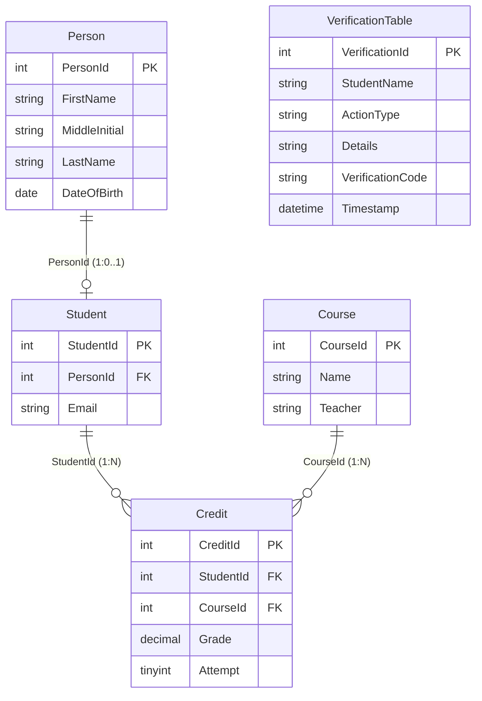

# IST 210 Lab 2: Relational Database CRUD Web Application

A fully functional, secure, and production-grade CRUD web application bridging relational database design with software engineering, connected to the Microsoft Learn tutorial database schema created in **Lab 1**.

Developed with AI-assisted software engineering (Google Antigravity) for **Penn State IST 210: Organization of Data**.

---

## 📋 Table of Contents
1. [Overview & Core Objectives](#-overview--core-objectives)
2. [Project Architecture & Structure](#-project-architecture--structure)
3. [Database Schema (Lab 1 Entities)](#-database-schema-lab-1-entities)
4. [Authentication & Cloud Database Integration](#-authentication--cloud-database-integration)
5. [Security by Design: Query Parameterization](#-security-by-design-query-parameterization)
6. [Referential Integrity Enforcement (ON DELETE NO ACTION)](#-referential-integrity-enforcement-on-delete-no-action)
7. [CRUD Operations Walkthrough](#-crud-operations-walkthrough)
8. [Quick Start & Setup Instructions](#-quick-start--setup-instructions)
9. [Deliverables & Submission Demonstration Guide](#-deliverables--submission-demonstration-guide)

---

## 🎯 Overview & Core Objectives

In Lab 2, you connect the relational database created in Lab 1 (hosted on Azure SQL Database or local SQL Server) to a multi-tiered web application implementing all four foundational database operations (Create, Read, Update, Delete).

### Core Objectives:
* **Cloud Database Integration:** Establish a secure connection from your backend to Azure SQL Database (`thisisalab-ist210.database.windows.net`) or local SQL Server using environment variables and ODBC drivers (`Microsoft ODBC Driver 17 for SQL Server`).
* **AI-Assisted Scaffolding:** Generate application routes, user interfaces, and database interaction logic tailored to the Lab 1 schema.
* **Security by Design:** Enforce strict query parameterization across **all** SQL statements to eliminate SQL Injection (SQLi) vectors.
* **Referential Integrity Enforcement:** Validate parent-child foreign key constraints and referential action rules (`ON DELETE NO ACTION`) during record insertions, modifications, and deletions.

---

## 📂 Project Architecture & Structure

```text
ist210-lab2-crud/
│
├── app.py                   # Main Flask application with CRUD routes & validation
├── db.py                    # Database connection manager & query abstraction layer
├── init_db.py               # Schema migration & seed script for Azure SQL/ODBC/SQLite
├── schema.sql               # Transact-SQL (T-SQL) DDL definitions for Lab 1 tables
├── standalone_server.py     # Zero-dependency launcher (Python standard library fallback)
│
├── .env                     # Active configuration file (ignored by version control)
├── .env.example             # Template configuration file with documentation
├── requirements.txt         # Python package dependencies (Flask, pyodbc, python-dotenv)
├── run.bat                  # One-click Windows Command Prompt launcher
├── run.ps1                  # One-click Windows PowerShell launcher
│
├── templates/               # Jinja2 template views (Bootstrap 5 UI)
│   ├── base.html            # Main responsive layout, navbar & alert modals
│   ├── dashboard.html       # READ: Multi-table SQL JOIN dashboard & statistics
│   ├── person_list.html     # Person catalog view
│   ├── person_form.html     # CREATE / UPDATE: Person form interface
│   ├── student_list.html    # Student catalog view with enrollment badges
│   ├── student_form.html    # CREATE / UPDATE: Student registration interface
│   ├── course_list.html     # Course catalog view
│   ├── course_form.html     # CREATE / UPDATE: Course management interface
│   ├── credit_list.html     # Credit & enrollment record listing
│   ├── credit_form.html     # CREATE / UPDATE: Grade & attempt assignment interface
│   └── verification_list.html # Lab audit log for dbo.VerificationTable
│
└── static/
    └── css/
        └── styles.css       # Custom styling, animations & status badges
```

---

## 🗄️ Database Schema (Lab 1 Entities)

The database schema directly reflects the Microsoft Learn Azure SQL tutorial module (*"Design a relational database in Azure SQL Database"*):



### Table Definitions & Foreign Key Constraints:
1. **`dbo.Person` (Parent Identity Table):**
   * Primary Key: `PersonId` (IDENTITY)
   * Attributes: `FirstName`, `MiddleInitial`, `LastName`, `DateOfBirth`
2. **`dbo.Student` (Child of Person):**
   * Primary Key: `StudentId` (IDENTITY)
   * Foreign Key: `PersonId` referencing `Person(PersonId)` with `ON DELETE NO ACTION`
   * Attributes: `Email`
3. **`dbo.Course` (Master Operational Catalog):**
   * Primary Key: `CourseId` (IDENTITY)
   * Attributes: `Name`, `Teacher`
4. **`dbo.Credit` (Associative Junction Table):**
   * Primary Key: `CreditId` (IDENTITY)
   * Foreign Key 1: `StudentId` referencing `Student(StudentId)` with `ON DELETE NO ACTION`
   * Foreign Key 2: `CourseId` referencing `Course(CourseId)` with `ON DELETE NO ACTION`
   * Check Constraint: `CHECK (Grade >= 0.00 AND Grade <= 100.00)`
   * Unique Constraint: `UNIQUE (StudentId, CourseId, Attempt)`
5. **`dbo.VerificationTable` (Lab Audit & Checkpoint Table):**
   * Attributes: `VerificationId`, `StudentName`, `ActionType`, `Details`, `VerificationCode`, `Timestamp`

---

## 🔐 Authentication & Cloud Database Integration

The connection module (`db.py`) is decoupled from hardcoded credentials and controlled entirely through `.env` variables:

### 1. Windows Authentication (Local SQL Server / Domain)
To connect using your Windows user credentials (`Trusted_Connection=yes;Integrated Security=True;`):
```ini
DB_AUTH_MODE=windows
DB_SERVER=localhost
DB_DATABASE=ist210-db-dong
DB_DRIVER={ODBC Driver 17 for SQL Server}
```

### 2. Azure SQL Database (SQL Authentication)
To connect to your cloud Azure SQL Database instance (`thisisalab-ist210.database.windows.net`):
```ini
DB_AUTH_MODE=sql
DB_SERVER=thisisalab-ist210.database.windows.net
DB_DATABASE=ist210-db-dong
DB_USER=your_azure_admin_login
DB_PASSWORD=your_azure_password
DB_DRIVER={ODBC Driver 17 for SQL Server}
```

### 3. Microsoft Entra / Azure AD Interactive
To connect using university MFA or Azure Active Directory:
```ini
DB_AUTH_MODE=azure_ad
DB_SERVER=thisisalab-ist210.database.windows.net
DB_DATABASE=ist210-db-dong
DB_USER=your_email@psu.edu
DB_DRIVER={ODBC Driver 17 for SQL Server}
```

### 4. Zero-Configuration Local SQLite Fallback
If working offline or demonstrating without Azure network credentials, the application automatically activates local SQLite fallback with complete schema parity and `PRAGMA foreign_keys = ON;`.

---

## 🛡️ Security by Design: Query Parameterization

All database queries across `app.py` and `db.py` enforce strict query parameterization:

```python
# ❌ INSECURE (Vulnerable to SQL Injection):
cursor.execute(f"SELECT * FROM Person WHERE LastName = '{user_input}'")

# ✅ SECURE (Enforced across this application):
cursor.execute("SELECT * FROM Person WHERE LastName = ?", (user_input,))
```

Parameterized queries treat user input strictly as literal values rather than executable SQL syntax, eliminating SQL Injection vulnerabilities.

---

## ⛓️ Referential Integrity Enforcement (ON DELETE NO ACTION)

The relational schema implements `ON DELETE NO ACTION` on all parent-child relationships. The application enforces this at two layers:

### Layer 1: Application-Level Pre-Deletion Validation
Before dispatching a `DELETE` query, the application runs verification helpers:
```python
def can_delete_person(self, person_id: int) -> Tuple[bool, str]:
    child_students = self.query_all("SELECT StudentId, Email FROM Student WHERE PersonId = ?", (person_id,))
    if child_students:
        return False, f"Cannot delete Person #{person_id}: Blocked by ON DELETE NO ACTION rule. Referenced by active student(s)."
    return True, "Safe to delete."
```

### Layer 2: Database Engine Exception Handling
If an unexpected foreign key constraint violation occurs (Error 547 in SQL Server / SQLite constraint error), `db.py` catches the error, rolls back the transaction, and surfaces a user-friendly alert message rather than crashing with an unhandled 500 error.

---

## 🖥️ CRUD Operations Walkthrough

| Operation | Route | Description |
| :--- | :--- | :--- |
| **READ** | `GET /dashboard` | Executes a **4-table SQL JOIN** (`Student` &rarr; `Person` &rarr; `Credit` &rarr; `Course`) displaying consolidated academic records alongside real-time search filtering and summary metrics. |
| **CREATE** | `POST /persons/create`<br>`POST /students/create`<br>`POST /courses/create`<br>`POST /credits/create` | Responsive HTML forms inserting new records into primary operational tables with validation. |
| **UPDATE** | `POST /persons/edit/<id>`<br>`POST /students/edit/<id>`<br>`POST /courses/edit/<id>`<br>`POST /credits/edit/<id>` | Form interfaces to modify operational parameters for existing records. |
| **DELETE** | `POST /persons/delete/<id>`<br>`POST /students/delete/<id>`<br>`POST /courses/delete/<id>`<br>`POST /credits/delete/<id>` | Safe removal workflow validating referential actions and preventing orphaned records. |

---

## 🚀 Quick Start & Setup Instructions

### Option A: One-Click Launch (Windows)
Double-click `run.bat` or open PowerShell in the project directory and run:
```powershell
.\run.ps1
```

### Option B: Manual Setup
1. **Open Terminal / PowerShell** and navigate to the project directory:
   ```powershell
   cd C:\Users\afd6098\.gemini\antigravity\scratch\ist210-lab2-crud
   ```
2. **Install Python dependencies (if desired):**
   ```powershell
   pip install -r requirements.txt
   ```
3. **Initialize the Database:**
   ```powershell
   python init_db.py
   ```
4. **Start the Application:**
   ```powershell
   python app.py
   # OR (if running in zero-dependency standalone mode):
   python standalone_server.py
   ```
5. **Open Browser:**
   Navigate to [http://localhost:5000](http://localhost:5000)

---

## 📸 Deliverables & Submission Demonstration Guide

For your Lab 2 submission, capture the following live operations interacting with the application:

1. **Dashboard Read (JOIN):**
   * View [http://localhost:5000/dashboard](http://localhost:5000/dashboard). Highlight the 4-table SQL JOIN view showing Student, Person, Course, and Grade data.
2. **Create Operation:**
   * Go to **Persons &rarr; Add New Person**, fill out the form and submit.
   * Go to **Students &rarr; Register Student**, link the newly created Person and submit.
   * Go to **Credits &rarr; New Enrollment**, assign a Course, Grade, and Attempt.
3. **Update Operation:**
   * Click **Edit** on a Credit record or Person record, update a field (e.g., change Grade from 88 to 95), and save.
4. **Delete Operation & Referential Integrity Demonstration:**
   * **Test Blocked Delete:** Try deleting a Person who has an active Student record. Capture the alert banner showing:
     `Referential Integrity Rule (ON DELETE NO ACTION): Cannot delete Person because an active Student references it.`
   * **Test Safe Delete:** Delete an individual Credit record (leaf node). Confirm that removal succeeds safely.
5. **Verification Checkpoint:**
   * Open the **Verifications** tab and log a checkpoint with your name to generate a persistent timestamped verification code in `dbo.VerificationTable`.
